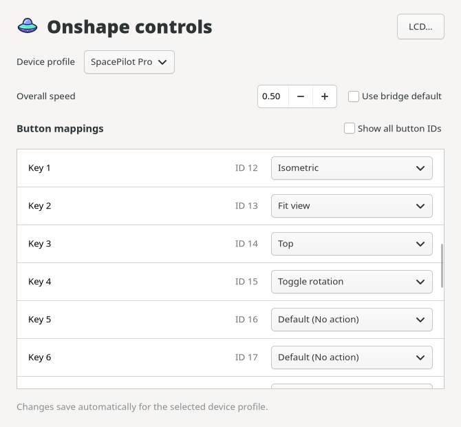
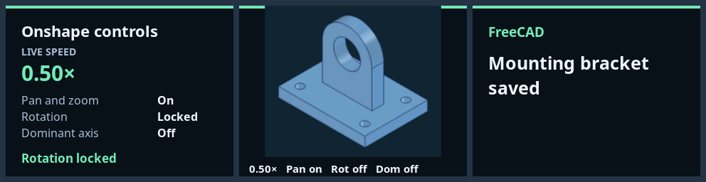
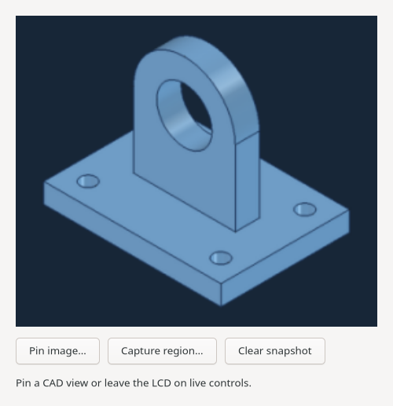

# Akita SpaceMouse for Linux


**3Dconnexion SpaceMouse support for Onshape on Linux.** Pan, zoom, and orbit a Part Studio or Assembly with a six-degree-of-freedom (6DoF) 3D mouse.

[Quick start](#quick-start) · [Onshape setup](#onshape-setup) · [Supported devices](#supported-3dconnexion-devices) · [SpacePilot Pro LCD](#spacepilot-pro-lcd) · [Troubleshooting](#troubleshooting)



## What you can do

- **Start the bridge at sign-in.** It translates `spacenavd` motion and button events for your browser and restarts if it exits.
- **Give each 3D mouse its own controls.** In the GTK 4 settings app, set per-model speed and map buttons to Fit view, isometric and orthographic views, rotation lock, dominant axis, and more. Settings save as you change them.
- **Use the KDE Plasma system tray.** The UFO shows bridge status and opens Settings, starts or stops the LCD stream, and jumps directly to CAD snapshots.
- **Put the SpacePilot Pro LCD to work.** See live navigation speed and locks, pin part views from Onshape or FreeCAD, and opt into brief KDE Plasma notifications on the 320 × 240 screen.

## Quick start

Use a desktop Linux system with systemd, internet access, and sudo for driver setup. The installer supports Arch Linux and CachyOS, Debian, Ubuntu, Fedora Workstation, and derivatives with the corresponding package repositories. [Fedora socket troubleshooting](#fedora-spacenavd-socket)

Plug in your device and run these commands as your regular desktop user.

```sh
git clone https://github.com/AkitaEngineering/Akita-SpaceMouse-Linux.git
cd Akita-SpaceMouse-Linux
./spacemouse install
./spacemouse doctor
./spacemouse
```

The installer sets up `spacenavd`, the isolated Onshape bridge, the SpaceMouse Settings launcher, and the tray. It verifies the upstream driver’s published SHA-256 digest when it needs to build a newer driver. Complete the browser setup below after installation.

These screenshots show the current `main` branch. Versioned release archives contain the features of their tag. For an archive install, download the `.tar.gz` and `SHA256SUMS`, run `sha256sum -c SHA256SUMS` in the download directory, and run `./spacemouse install` from the extracted folder. [GitHub releases](https://github.com/AkitaEngineering/Akita-SpaceMouse-Linux/releases)

## Onshape setup

1. Open <https://127.51.68.120:8181> in the browser profile you use for Onshape. Accept the self-signed certificate for this local address, then move the cap to check for motion on the test page.
2. Install a userscript manager in the same browser profile and enable the Onshape Linux userscript. It lets Onshape discover the bridge. [spacenav-ws browser setup](https://github.com/RmStorm/spacenav-ws#usage)
3. Open or reload an Onshape Part Studio or Assembly. Allow local or loopback access if the browser prompts, click the viewport, and move the cap. [Chrome site permissions](https://support.google.com/chrome/answer/114662)

For everyday use, open Onshape as usual or run `spacemouse onshape`. The bridge listens on this computer only. Use `spacemouse serve --no-browser` to start it without opening a tab. If your shell cannot find `spacemouse`, use `~/.local/bin/spacemouse`.

## Supported 3Dconnexion devices

| Device | Onshape profile | LCD features |
| --- | --- | --- |
| SpaceMouse Compact and SpaceMouse Wireless | Named left and right buttons | |
| SpaceMouse Pro and SpaceMouse Pro Wireless | Named function keys, view buttons, Fit, and rotation lock | |
| SpacePilot | Named buttons, including view and speed controls | |
| SpacePilot Pro | Named buttons, including view controls, roll, locks, dominant axis, and speed | Live controls, CAD snapshots, and Plasma notifications |
| SpaceNavigator and SpaceNavigator for Notebooks | Named left and right buttons | |
| SpaceMouse Classic and Plus | Numeric button IDs | |
| Other compatible six-axis devices | Generic profile with numeric button IDs | |

Testing included a physical SpacePilot Pro on CachyOS, KDE Plasma on Wayland, a public Onshape document in Chromium, simulated button and motion events, and LCD frame transfers. The other model profiles have simulated coverage. [FreeSpacenav device support](https://spacenav.sourceforge.net/)

### Other CAD apps

| App | How to use it |
| --- | --- |
| FreeCAD | Use a viewport capture or exported image as a SpacePilot Pro LCD snapshot. [FreeCAD image export](https://freecad.github.io/SourceDoc/d3/df7/classGui_1_1View3DInventorPy.html) |
| Layerling | In Chrome or Edge, open a design and choose **Workspace settings → Controls → Connect 3D mouse**. Layerling reads input in the browser. [Layerling controls](https://layerling.com/guide/view-and-workplane.html) |
| Tinkercad | Use the community extension when Chrome recognises the device through its Gamepad API. [SpaceMouse in TinkerCAD extension](https://chromewebstore.google.com/detail/spacemouse-in-tinkercad/nhaenepgppfpehodifndkalcidjhkpjo) |

Layerling’s connection controls and Linux device access were checked. Physical navigation in Layerling and Tinkercad remains unverified.

## Onshape button mappings

Open **Application Launcher → System → SpaceMouse Settings** in KDE Plasma, choose **Open SpaceMouse Settings** from the UFO tray, or run `spacemouse settings`. The app selects the detected profile when available. You can edit any profile with the device unplugged.

- Choose an action next to a button. It takes effect on the next press in the focused Onshape viewport.
- Select **Default** to restore the built-in action. Choose **Show all button IDs** to edit an unlabelled button.
- Clear **Use bridge default** and set **Overall speed** to a multiplier from `0.25` to `4`. For example, `0.50` halves the bridge’s motion speed for that model. You can leave the viewport open while adjusting it.

The app saves button assignments in `~/.config/spacemouse/buttons.json` and per-model speeds in `speeds.json` in the same directory. It follows `XDG_CONFIG_HOME` when configured. Speed and lock buttons adjust the current viewport session.

### Map buttons from the terminal

```sh
spacemouse buttons
spacemouse buttons watch
spacemouse buttons actions
spacemouse buttons --model spacepilot-pro set key-1 isometric
spacemouse buttons --model spacepilot-pro default key-1
```

`watch` shows the label and numeric ID when you press a button. Use the displayed ID if you remap buttons in `/etc/spnavrc`.

## SpacePilot Pro LCD



*Rendered by the LCD code at 320 × 240 per frame using example data and a sample FreeCAD model.*

Choose **Start LCD** from the UFO tray. While an Onshape viewport has focus, the screen shows live speed, pan and zoom lock, rotation lock, and dominant-axis mode. Button actions flash briefly, such as **Rotation locked**. When the viewport loses focus, the LCD shows the clock, saved speed, and the first four key assignments.

### Pin an Onshape or FreeCAD snapshot



Open **LCD Snapshots…** from the tray or **LCD…** from SpaceMouse Settings. You can also run `spacemouse settings --lcd`.

- **Capture region…** opens KDE Spectacle so you can select just the CAD viewport. Install Spectacle to use region capture. [Spectacle region capture](https://docs.kde.org/stable_kf6/en/spectacle/spectacle/using.html)
- **Pin image…** opens a local PNG or JPEG, such as a saved Onshape screenshot or an exported FreeCAD view. The image keeps its proportions and stays pinned across sessions.
- **Clear snapshot** returns the screen to live controls or the dashboard. While a snapshot is pinned, it shows a compact Onshape controls caption when the viewport has focus.

Enable **Show Plasma notifications on LCD** in the tray to briefly display an app name and notification summary. When the alert clears, the current CAD view or dashboard returns.

For terminal use, stop the tray’s LCD stream and run `spacemouse display` for a foreground stream, `spacemouse display --once` for one LCD refresh, or `spacemouse display --notifications` for a foreground stream with alerts.

## KDE Plasma system tray and startup

The UFO appears in KDE Plasma when you sign in. Its indicator is green when the Onshape bridge service is active and amber when it needs attention. The menu shows bridge and LCD status and offers **Open SpaceMouse Settings**, **LCD Snapshots…**, **Start LCD** or **Stop LCD**, and the notification toggle. Run `spacemouse tray` to bring the UFO back after quitting it.

`spacenavd` starts at boot. The bridge starts at sign-in. If you need the bridge before sign-in or after sign-out, `loginctl enable-linger "$USER"` applies user-service lingering to your account. [systemd user lingering](https://www.freedesktop.org/software/systemd/man/latest/loginctl.html)

```sh
systemctl --user status spacemouse-bridge.service spacemouse-tray.service
systemctl --user restart spacemouse-bridge.service
systemctl --user disable --now spacemouse-bridge.service
systemctl --user enable --now spacemouse-bridge.service
```

## Motion tuning

`spacemouse tune` edits driver settings for apps that use `spacenavd`. A multiplier of `1` is the baseline. Raise the dead zone if the view drifts after you release the cap, and use `--save` to keep the settings across driver restarts or `--restore` to reload the saved settings. The driver uses `/etc/spnavrc`.

```sh
spacemouse tune
spacemouse tune --translation 0.75 --rotation 1.2 --dead-zone 4
spacemouse tune --invert-rotation y
spacemouse tune --save
```

The Onshape bridge has a default multiplier of `1` for profiles that use **Use bridge default**. To change this fallback, run `systemctl --user edit spacemouse-bridge.service`, add the setting below, and restart the bridge.

```ini
[Service]
Environment=SPACEMOUSE_ONSHAPE_SENSITIVITY=0.5
```

## Troubleshooting

| What you see | What to check |
| --- | --- |
| `spacemouse doctor` cannot reach the driver | Check `systemctl status spacenavd.service` and `journalctl -u spacenavd.service -b`. For a read-only socket directory on Fedora, see [Fedora spacenavd socket](#fedora-spacenavd-socket). |
| The driver runs and the device is missing | Reconnect the USB cable or receiver. Older serial models need a port in `/etc/spnavrc`. [Example driver configuration](https://github.com/FreeSpacenav/spacenavd/blob/v1.4/doc/example-spnavrc) |
| The device is detected and Onshape stays still | Run `spacemouse test` and move the cap. If events appear, check the local certificate and the userscript in the same browser profile, then reload Onshape. |
| The bridge or tray has stopped | Check `journalctl --user -u spacemouse-bridge.service -b` or `journalctl --user -u spacemouse-tray.service -b`. Start the tray with `spacemouse tray`. |
| The LCD stream cannot start | Check `journalctl --user -u spacemouse-lcd.service -b`. The LCD interface accepts one writer at a time. Use **Stop LCD** to release the tray’s stream. [LCD permissions](#spacepilot-pro-usb-access) |
| The Tinkercad extension detects the device and gets no motion | If `spacenavd` has grabbed the device, set `grab = false` in `/etc/spnavrc` and run `sudo systemctl restart spacenavd`. [Driver configuration](https://github.com/FreeSpacenav/spacenavd/blob/v1.4/doc/example-spnavrc) |

For a bug report, include your launcher version, Linux distribution, device, browser, output from `spacemouse doctor`, and whether `spacemouse test` showed motion. [GitHub issues](https://github.com/AkitaEngineering/Akita-SpaceMouse-Linux/issues) · [Support guide](SUPPORT.md)

### Fedora spacenavd socket

On affected Fedora 44 and 45 `spacenavd` builds, the service can start while `/run` is read-only from its mount namespace. If its journal reports `failed to bind unix socket` and `Read-only file system` for `/var/run/spnav.sock`, run `sudo systemctl edit spacenavd.service` and add a service-specific exception. [Fedora 44 build](https://bodhi.fedoraproject.org/updates/FEDORA-2026-e07ab23057) · [Fedora 45 build](https://bodhi.fedoraproject.org/updates/FEDORA-2026-220c94522f)

```ini
[Service]
ReadWritePaths=/run
```

Restart the driver and rerun the installer from the project folder.

```sh
sudo systemctl restart spacenavd.service
./spacemouse install
```

### SpacePilot Pro USB access

If the LCD reports that your session lacks USB access, add this rule to `/etc/udev/rules.d/70-akita-spacepilot-pro-lcd.rules`, run `sudo udevadm control --reload-rules`, and reconnect the device.

```udev
SUBSYSTEM=="usb", ENV{DEVTYPE}=="usb_device", ATTR{idVendor}=="046d", ATTR{idProduct}=="c629", TAG+="uaccess"
```

## Update or uninstall

Update the source or extract a newer release, then run `./spacemouse install` from that folder. The installer reloads the bridge and tray and restarts the managed LCD stream if it is active. Stop any foreground bridge or LCD stream with Ctrl+C before updating.

```sh
spacemouse uninstall --dry-run
spacemouse uninstall
```

Uninstall removes the launcher, settings app, tray, LCD service, and isolated bridge. It keeps saved profiles, LCD settings, `/etc/spnavrc`, the distro driver, and shared packages. Use `--purge` to remove local profiles, speeds, the pinned image, notification preference, and the installed service agreement. Use `--restore-driver` to remove an upstream driver installed by this project and return to the distro service.

## Community Edition and paid support

The GPL-3.0-only Community Edition is an Akita Engineering project. Install it on as many compatible Linux machines as you like. The software runs without an account or licence key. Akita Engineering offers paid remote setup, fleet deployment, and support under software model **ASM-LNX-CE**. [Akita Engineering](https://www.akitaengineering.com) · [License](LICENSE) · [Price list](COMMERCIAL.md)

Prices exclude tax. Use the column for the billing customer’s country. Other countries are quoted on request.

| Service | United States | Canada | European Union |
| --- | ---: | ---: | ---: |
| Remote setup for one workstation, up to 45 minutes. ASM-SET-1-US, ASM-SET-1-CA, ASM-SET-1-EU | US$109 | C$149 | €99 |
| On-demand troubleshooting, per hour. ASM-SUP-H-US, ASM-SUP-H-CA, ASM-SUP-H-EU | US$149 | C$169 | €119 |
| Fleet pilot, up to five workstations on one Linux and browser configuration. ASM-FLT-5-US, ASM-FLT-5-CA, ASM-FLT-5-EU | US$499 | C$649 | €449 |
| Assisted rollout after a successful pilot, per additional matching workstation. ASM-ROL-1-US, ASM-ROL-1-CA, ASM-ROL-1-EU | US$39 | C$49 | €39 |
| Monthly team support, up to ten covered workstations and one pooled hour. ASM-SUB-10-US, ASM-SUB-10-CA, ASM-SUB-10-EU | US$149 | C$199 | €139 |

For a quote, include the billing country, Linux distributions, browser, device models, and workstation count. [Email Akita Engineering](mailto:info@akitaengineering.com?subject=Akita%20SpaceMouse%20services) · [Sales sheet](SALES.md) · [Service terms](SERVICE-TERMS.md)

### Service agreements and support logs

Install the service agreement Akita sends for paid work. Use `spacemouse support` to check which logs are available, and `spacemouse support bundle` to create a local archive you can send to support. Akita checks covered workstations and included time when it accepts the bundle. [Support guide](SUPPORT.md)

```sh
spacemouse agreement install agreement.json
spacemouse agreement
spacemouse support
spacemouse support bundle
```

## Development and credits

```sh
python3 -m venv .venv
.venv/bin/python -m pip install spacenav-ws
bash -n spacemouse
bash -n install.sh
.venv/bin/python -m unittest discover -s tests -v
```

Copyright © 2026 Akita Engineering. SpaceMouse, SpacePilot, and SpaceNavigator are 3Dconnexion product names. [Release history](CHANGELOG.md) · [GPL-3.0-only license](LICENSE)

The device driver and Onshape protocol build on FreeSpacenav and spacenav-ws. Device profiles use the documented HID and logical button orders. LCD support uses the independently documented G19-compatible USB interface. [FreeSpacenav](https://github.com/FreeSpacenav/spacenavd) · [spacenav-ws](https://github.com/RmStorm/spacenav-ws) · [Blender HID maps](https://github.com/blender/blender/blob/main/intern/ghost/intern/GHOST_NDOFManager.cc) · [FreeSpacenav logical button order](https://github.com/FreeSpacenav/spacenavd/blob/v1.4/src/dev.c) · [3dxdisp-pro](https://github.com/MiguelDLM/3dxdisp-pro) · [libg19](https://github.com/jgeboski/libg19)
